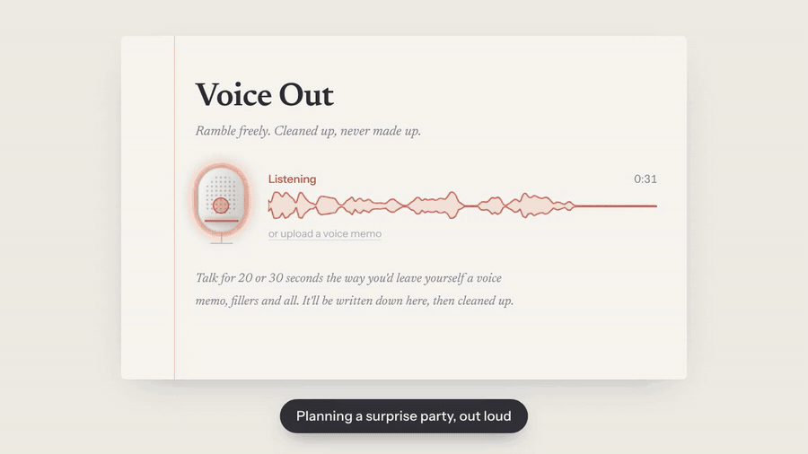
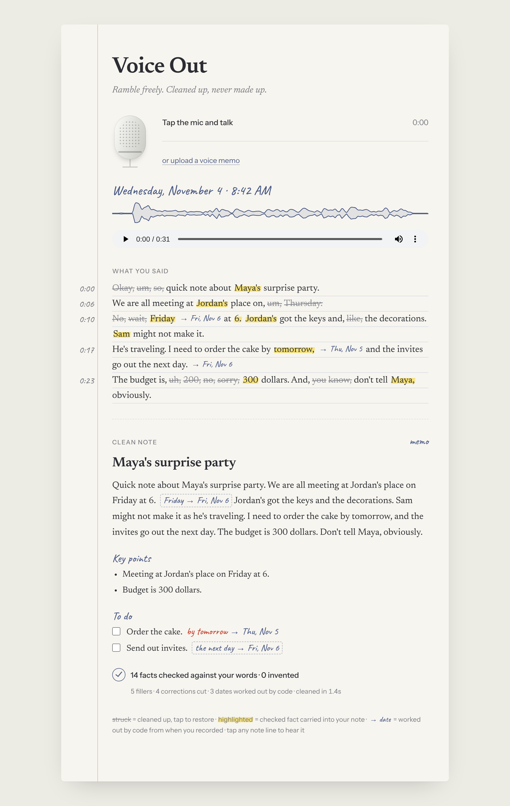
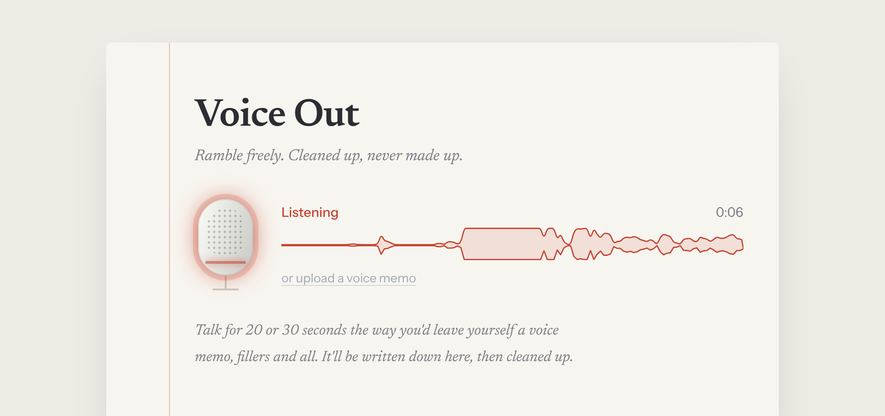
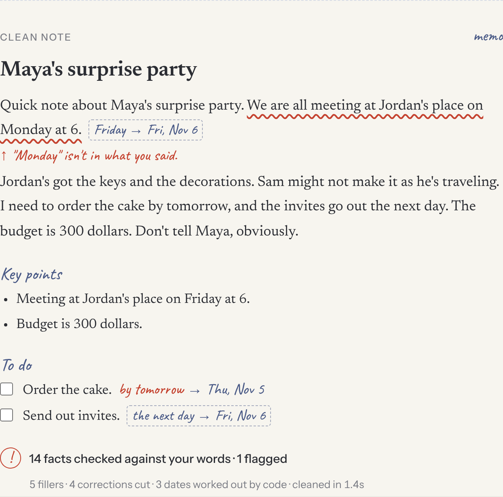
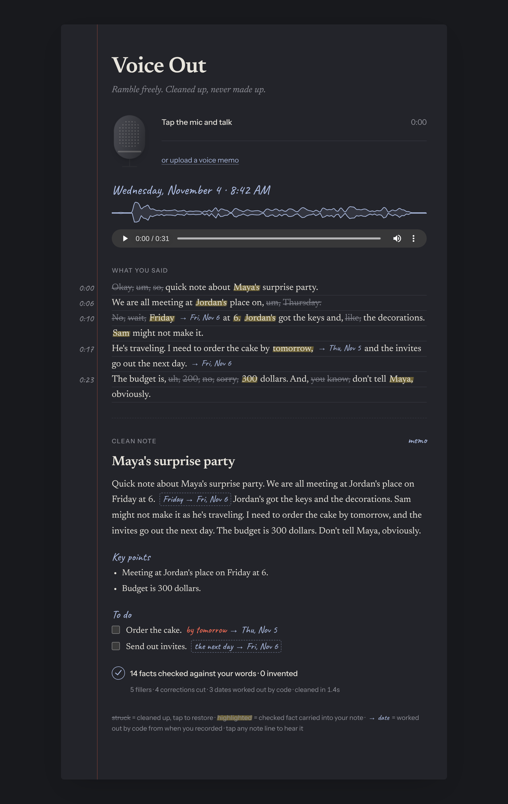
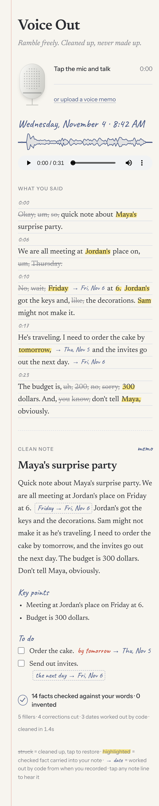
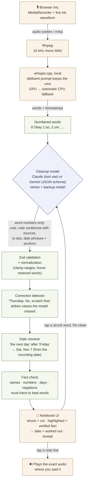

# Voice Out

**Ramble freely. Cleaned up, never made up.**

Talk into your mic the way you'd leave yourself a voice memo, fillers, false starts and "no wait, Friday" included. Voice Out writes it down as a clean note, and shows its receipts for every change it made.

<p align="center">
  
</p>

<p align="center">
  <a href="docs/voice-out-demo.mp4"><b>▶ Watch the 1-minute walkthrough</b></a>
  ·
  <a href="#try-it-in-one-command">Try it in one command</a>
  ·
  <a href="#how-it-works">How it works</a>
  ·
  <a href="#evals">Evals</a>
</p>

<p align="center">
  <a href="https://github.com/GITHUB_USERNAME/voice-out/actions/workflows/ci.yml"></a>
  
  
  
  
</p>

> **A portfolio project by [@GITHUB_USERNAME](https://github.com/GITHUB_USERNAME).** Voice Out is a working app, built to explore one question: *how do you make an AI's edits to your own words trustworthy?* See [what it demonstrates](#what-this-project-demonstrates).

---

## The problem

Voice-note and dictation apps are good at turning speech into tidy text. But they're black boxes: you speak, polished text comes back, and you can't tell what was cut, what was reworded, or whether something was quietly made up.

For notes you'll act on, that matters more than an "um". A dropped *not* ("don't tell Maya") or an invented deadline ("by Friday" when you said Thursday) is a real mistake, and you won't notice it because the text reads fine.

## What Voice Out does differently

**It treats the AI as a draft, and checks it with plain code.**

| | Typical voice-note / dictation app | Voice Out |
| --- | --- | --- |
| What was removed | Gone; you can't see it | Struck through in your transcript, with the reason (filler, repeat, false start, correction). Tap to restore. |
| Is the note faithful? | Trust the model | Every name, number, date and negation is checked against the words you actually said, by deterministic code. The receipt says how many were checked and flags any that don't trace back. |
| "No wait, Friday" | Depends on the model | Corrections are detected in code too, so a value you took back can't slip into the note, even if the model misses it. |
| "The next day" | Left as-is, or the model guesses a date | The model links "the next day" to "Friday"; code does the calendar math from the day you recorded. Shown as a pencil note, never as your words. |
| Where a sentence came from | Unknown | Point at any note line to light up its source words; tap to hear yourself say it. |
| Your audio | Usually uploaded | Transcribed locally on your Mac with whisper.cpp. Only text goes to the model. |
| Proof it works | Marketing | An eval suite of tricky rambles, with published numbers. |

How this compares to well-known tools (as of November 2026):

- **[Wispr Flow](https://en.wikipedia.org/wiki/Wispr_Flow)** is excellent system-wide dictation: it removes fillers as you type anywhere, but it's cloud-only and shows only the cleaned result.
- **[AudioPen](https://www.audiopen.ai/)** turns rambles into polished writing in a chosen style, which by design rewrites your words.
- **[Superwhisper](https://superwhisper.com/)** is a highly configurable Mac transcription tool with local models and custom AI modes.

Those tools optimize for **speed and polish**. Voice Out optimizes for **trust**: it's for notes you'll act on later, where *"did I actually say that?"* has to have an answer. (Comparison based on each product's public descriptions; see [AudioPen's own comparison](https://www.audiopen.ai/blog/wispr-flow-vs-superwhisper-vs-audiopen), which is written by a competitor and worth reading with that in mind.)

## Screenshots

**A real memo, cleaned.** Struck words were cut (hover for why), highlighted words are facts the code verified, and pencil notes are dates it worked out. The receipt at the bottom is the check.



| Recording | When something doesn't add up* | Dark mode | Phone |
| --- | --- | --- | --- |
|  |  |  |  |

<sub>*To show a flag, one day in the note was swapped on purpose with [`scripts/tamper-demo.ts`](scripts/tamper-demo.ts); the red flag is the real fact check's output.</sub>

## Try it in one command

No Whisper, no API key:

```bash
git clone https://github.com/GITHUB_USERNAME/voice-out.git
cd voice-out
npm install
npm run demo        # open http://localhost:5173 and press the mic
```

Demo mode replays a real captured memo (my voice, Whisper's transcript and Gemini's actual cleanup, saved in [`demo/`](demo)). Whatever you record becomes that memo, but the correction detector, the date math and the fact check all run live.

## Run it with your own voice (macOS)

Needs Node 22.12+, [Homebrew](https://brew.sh), and one API key: a free [Gemini key](https://aistudio.google.com/apikey) or an [Anthropic key](https://console.anthropic.com).

```bash
npm install
npm run setup:whisper   # installs whisper-cpp + ffmpeg, downloads the small.en model (~470 MB),
                        # tests GPU vs CPU, and creates .env
# put ONE key in .env:  GEMINI_API_KEY=...   or   ANTHROPIC_API_KEY=sk-ant-...
npm run dev             # http://localhost:5173
```

| Provider | Default model | Cost | Notes |
| --- | --- | --- | --- |
| Gemini | `gemini-3.1-flash-lite` (backup: `gemini-3.5-flash-lite`) | Free tier | Rate-limited. On the free tier Google may use requests to improve its products. |
| Claude | `claude-haiku-5-5` | A fraction of a cent per memo | `CLAUDE_MODEL=claude-sonnet-5-5` for harder memos |

If both keys are set, Claude is used; `CLEANUP_PROVIDER=gemini` overrides that. The prompt, schema and checks are identical for both, so the receipts mean the same thing whichever model wrote the note.

## How it works



Blue is the one AI step. Green is plain, deterministic TypeScript that checks it. Orange stays on your machine.

### 1. Whisper is told to keep the ums

Whisper was trained largely on tidy subtitles and tends to delete fillers. Voice Out primes the decoder with a deliberately disfluent prompt, so the transcript shows what you really said. It also turns Whisper's sub-word tokens into words with timestamps, drops internal markers like `<|endoftext|>`, and splits run-on stretches into timed lines at pauses.

### 2. The model points at words; it never rewrites the transcript

The transcript goes to the model as numbered words. It returns **ranges of word numbers** to cut (each with a reason), and every note sentence, key point and to-do **cites the word range it came from**. The transcript you see is always Whisper's exact output, so the AI can't silently alter it. Output is forced into shape (a tool call for Claude, structured JSON for Gemini) and validated with the same [Zod schema](apps/server/src/clean/schema.ts) that generates both JSON Schemas.

### 3. Plain code checks the note

[`verify/facts.ts`](apps/server/src/verify/facts.ts) extracts every name, number, weekday, month, time and relative date from the note, and looks for each among the **kept** words near the cited span. It handles "twenty five" ↔ 25, possessives ("Sunena's,"), and abbreviations, and flags:

| Problem | Example |
| --- | --- |
| Not said | The note says "by Friday"; you never said Friday |
| Corrected | You said "Thursday, no wait, Friday", but the note uses Thursday |
| Negation dropped | You said "don't tell Maya"; the note says "tell Maya" |
| Negation added | The note says "don't"; you didn't |

It also runs its own **correction detector** ("X. No, scratch that.", "X, no, Y", "forty, no sorry, fifty", "not the birthday party"), so a value you took back is struck and can't be used even when the model forgets to cut it.

### 4. Dates: the model links, code computes

The model lists date phrases by word position and, for relative ones ("the next day"), points at the day they hang off ("Friday"). [`dates/resolve.ts`](apps/server/src/dates/resolve.ts) does the calendar math from the day you recorded:

| You said (recorded Tue, Nov 3) | Voice Out shows |
| --- | --- |
| tomorrow | Wed, Nov 4 |
| Friday | Fri, Nov 6 |
| the next day *(after Friday)* | Sat, Nov 7 |
| the next Monday | Mon, Nov 9 |
| next Friday | Fri, Nov 13 (Friday of next week) |
| ASAP, soon, next week | *left alone on purpose* |

If the note itself says "Saturday" for "the next day", the fact check accepts it only because code worked it out.

### 5. You stay in control

Tap a struck word to restore it, then **Re-clean**: restored words go back as `mustKeep`, and the server removes them from any cut the model proposes. If the model is busy, Voice Out retries, tries a backup model, and keeps your transcript on screen with a **Try cleanup again** button, so you never re-record.

## Evals

[`apps/server/src/evals/cases.ts`](apps/server/src/evals/cases.ts) holds 13 rambles built to trip up a naive filler remover: "like" as a verb, "don't email Marcus", "twenty five chairs", "Tuesday, no wait, Wednesday", a corrected budget, feelings that aren't filler, relative dates, and two real recordings. Each case marks words that should be cut `[like this]` and words that must survive `{like this}`.

Results with **`gemini-3.1-flash-lite`** (free tier), run November 3, 2026:

| Metric | Result |
| --- | --- |
| Facts kept | **100%** (55/55) |
| Facts invented | **0** |
| Dates worked out correctly | **100%** (7/7) |
| Meaningful words kept ("like" as a verb, "kind of tea") | **100%** (6/6) |
| Fillers cut | **83%** (90/109) |

The fillers that remain are mostly stutters like "I need, I need to…" and a few test labels stricter than the meaning. **Every note in the run was clean.** Full per-case output: [`evals/RESULTS-gemini.md`](evals/RESULTS-gemini.md).

```bash
npm run eval                          # all cases, whichever provider .env selects
npm run eval -- party-planning        # one case
CLEANUP_PROVIDER=claude npm run eval  # compare models on the same cases
```

## Limitations

Being honest about these is part of the point:

- **The fact check covers facts, not tone.** It catches names, numbers, days and negations. It won't catch "probably" becoming "definitely", or a reworded opinion.
- **The correction detector knows common phrasings** ("no wait", "scratch that", "no sorry", "not the X"). An unusual correction relies on the model alone.
- **A whole corrected clause isn't always struck.** In "plan Leila's birthday party. Oh no, not the birthday party", the note correctly says *graduation* party, but the transcript may leave "birthday party" unstruck.
- **Free models under-cut some stutters** (83% of fillers in the evals). The note stays clean; the transcript shows a few extra unstruck words.
- **Date rules are English and opinionated.** "Next Friday" is read as Friday of next calendar week; the pencil note shows the date so you can see the choice.
- **Whisper word timings are approximate**, so tap-to-hear can start a fraction early or late.
- **Setup targets macOS.** Some whisper.cpp builds crash on Apple GPUs; setup detects this and uses the CPU.
- **Memos aren't saved yet.** Each recording replaces the last (see [roadmap](#roadmap)).

## What this project demonstrates

- **Constraining an LLM so its output can be verified:** the model returns word indices against a schema, never free text about the transcript.
- **Deterministic guardrails around a probabilistic step:** fact checking, correction detection and date arithmetic in plain, unit-tested TypeScript.
- **Evaluation as a habit:** a labeled eval suite, per-case diagnostics, and fixes driven by real failures (several cases and tests come from real recordings).
- **Provider-agnostic design:** Claude and Gemini behind one interface, with retries, a fallback model and clear error messages.
- **Local speech-to-text:** whisper.cpp via ffmpeg, token-to-word alignment, disfluency-preserving prompting, and GPU/CPU fallback.
- **Product and interface craft:** a notebook UI where every mark means something, in light and dark mode and at phone width.

## Scripts

| Command | What it does |
| --- | --- |
| `npm run demo` | Full UI with no Whisper and no API key |
| `npm run dev` | Server + web app with hot reload |
| `npm run dev:capture` | Like `dev`, and saves the memo you record to `demo/` for demo mode |
| `npm test` | 72 Vitest tests: Whisper parsing, cleanup, fact check, correction detector, dates, API, UI. No API key needed. |
| `npm run eval` | The real cleanup model on the eval cases |
| `npm run typecheck` / `npm run lint` | TypeScript (strict) + ESLint |
| `npm run setup:whisper` | Install whisper.cpp/ffmpeg, download a model (`-- base.en` or `-- medium.en` for others) |

## Project layout

```
apps/server/src
  transcribe/   ffmpeg + whisper.cpp; tokens → timed words and lines; GPU/CPU fallback
  clean/        shared prompt + Zod schema; Claude and Gemini providers; retries, fallback
  verify/       fact check and correction detector (plain TypeScript)
  dates/        spoken dates → calendar dates
  evals/        13 labeled cases + runner
  capture.ts    record a real memo into demo/
  demo.ts       replay it for npm run demo
apps/web/src
  components/   Recorder (mic + ink waveform), TranscriptView, NoteView
  hooks/        useRecorder, useClipPlayer (tap-to-hear)
  lib/          marks, dates, peaks
demo/           a real captured memo (audio, transcript, model cleanup)
evals/          published eval results
```

## Stack

TypeScript (strict) · React 18 + Vite · Fastify · whisper.cpp + ffmpeg · Claude (Anthropic SDK) or Gemini (Google GenAI SDK) · Zod · Vitest · ESLint · GitHub Actions

## Roadmap

- **Saved notebook:** keep memos locally (SQLite), with search and reopening any memo with tap-to-hear intact.
- **Hedge check:** flag "might" or "probably" disappearing from the note.
- **Strike whole corrected clauses**, not only the corrected value.

## License

[MIT](LICENSE) © GITHUB_USERNAME
